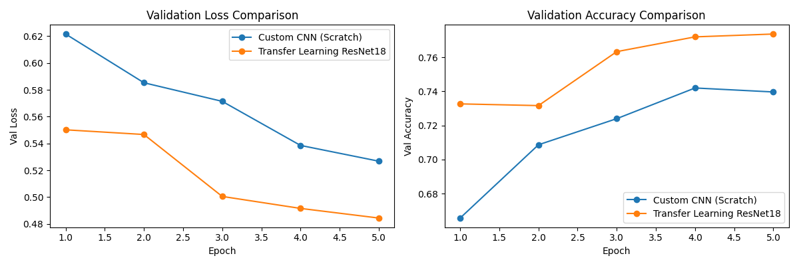
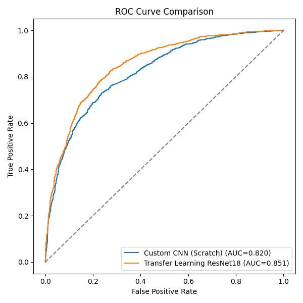
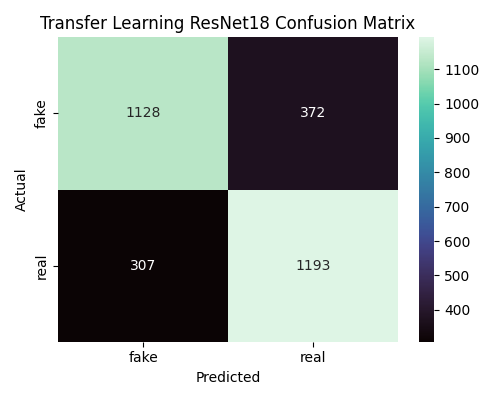

# Deepfake Face Detection: Custom CNN vs. Transfer Learning (ResNet18)

[](https://www.python.org/)
[](https://pytorch.org/)
[](https://colab.research.google.com/)
[](LICENSE)

An empirical comparative study investigating the effectiveness and efficiency trade-offs between a custom Convolutional Neural Network (CNN) built from scratch and a feature-extracted transfer learning model (ResNet18) for binary deepfake face classification on the RVF10K dataset.

---

##  Table of Contents
- [Overview](#-overview)
- [Key Results](#-key-results)
- [Dataset](#-dataset)
- [Architectures](#-architectures)
- [Citation & References](#-citation--references)

---

##  Overview

The rapid progression of generative adversarial networks (GANs) and diffusion models has made synthetic human faces virtually indistinguishable from genuine photographs. This repository contains a controlled benchmarking study comparing two vision approaches under identical training setups:

1. **Custom CNN (From Scratch):** A 3-layer convolutional network utilizing batch normalization, dropout, and max-pooling.
2. **Transfer Learning (ResNet18):** A frozen ResNet18 backbone pretrained on ImageNet, fine-tuning only a newly added 2-class classification head.

Both models were trained for **5 epochs** using the **Adam optimizer** ($\text{lr} = 0.0003$) on the class-balanced **RVF10K dataset** using an NVIDIA T4 GPU.

---

##  Key Results

The transfer learning model achieved superior predictive performance across all metrics while training **0.016%** of the parameters trained by the custom CNN.

| Model | Val Accuracy | Macro F1 | Macro Precision | Macro Recall | ROC AUC | Trainable Params | Total Params | Training Time (s) | Inference Time (ms/img) |
| :--- | :---: | :---: | :---: | :---: | :---: | :---: | :---: | :---: | :---: |
| **Custom CNN (Scratch)** | 73.97% | 0.7395 | 0.7404 | 0.7397 | 0.8196 | 6,446,722 | 6,446,722 | 358.96 | **5.532** |
| **Transfer ResNet18** | **77.37%** | **0.7736** | **0.7742** | **0.7737** | **0.8507** | **1,026** | 11,177,538 | **331.30** | 6.239 |

###  Performance Visualizations

| Validation Loss & Accuracy Comparison | ROC AUC Comparison |
| :---: | :---: |
|  |  |

| Custom CNN (Scratch) Confusion Matrix | Transfer Learning ResNet18 Confusion Matrix |
| :---: | :---: |
|  |  |

---

##  Dataset

This study uses the **RVF10K (Real vs. Fake 10K)** dataset, containing $10,000$ high-resolution face images divided into equal, class-balanced splits:

- **Training:** 3,500 real / 3,500 fake images
- **Validation:** 1,500 real / 1,500 fake images

### Preprocessing & Augmentations
- **Resizing:** $224 \times 224$ pixels
- **Normalization:** ImageNet mean $[0.485, 0.456, 0.406]$ and standard deviation $[0.229, 0.224, 0.225]$
- **Augmentations:** Random Horizontal Flip ($p = 0.5$) applied on the training split.

---

##  Architectures

### 1. Custom CNN (From Scratch)
- **Feature Extractor:** 3 Conv blocks (`Conv2d` $\rightarrow$ `BatchNorm2d` $\rightarrow$ `ReLU` $\rightarrow$ `MaxPool2d`), expanding channels from $16 \rightarrow 32 \rightarrow 64$.
- **Classifier Head:** Flatten $\rightarrow$ Linear ($50,176 \rightarrow 128$) $\rightarrow$ Dropout ($0.4$) $\rightarrow$ Linear ($128 \rightarrow 2$).

### 2. Transfer Learning (ResNet18)
- **Backbone:** ImageNet-pretrained ResNet18 with frozen feature extractor (`requires_grad = False`).
- **Classifier Head:** Custom Linear layer ($512 \rightarrow 2$).

# Citations & References

If you use this codebase, methodology, or experimental findings in your research or project, please cite this repository.

---

##  Repository Citation

```bibtex
@misc{reddy2026deepfake,
  author       = {Clianta Nagi Reddy},
  title        = {Deepfake Face Detection Using Convolutional Neural Networks: A Comparative Study},
  year         = {2026},
  publisher    = {GitHub},
  journal      = {GitHub Repository},
  howpublished = {\url{[https://github.com/your-username/deepfake-detection-cnn](https://github.com/your-username/deepfake-detection-cnn)}}
}

